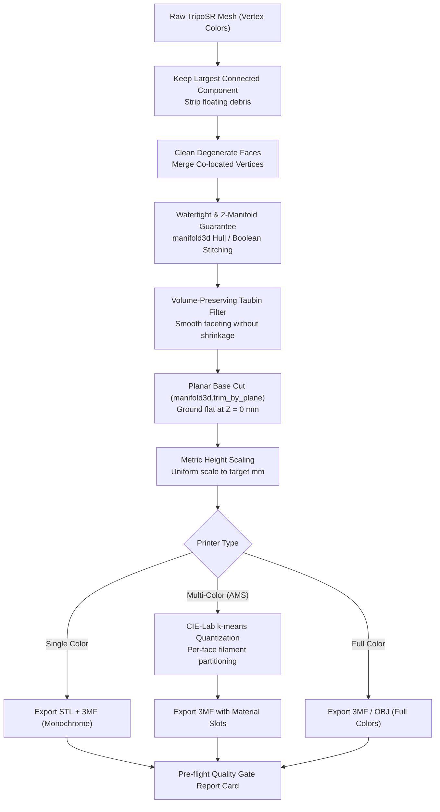

# 3d.me: Master Technical Specification & Architecture Context

> **Single Source of Truth**: This document details the complete technical architecture, AI models, hardware optimizations, print-ready pipeline, and operational instructions for **3d.me** (formerly MeshForge).

---

## 1. Project Overview & Identity

- **Application Name**: `3d.me`
- **Root Directory**: `~/Projects/3dme` (accessible via workspace `~/Downloads/3dme`)
- **Primary Goal**: A professional, offline-capable AI 3D creation and CAD studio running **100% locally on Apple Silicon (M1/M2/M3/M4)** with zero cloud GPU dependencies, zero third-party API fees (no paid APIs, no API keys, no Anthropic/Claude, no Meshy, no Tripo API), and total data privacy.
- **Current Core Capabilities**:
  - **Text → 3D Pipeline**: 
    - Automatic prompt framing and negative prompt sanitization.
    - 4 candidate 2D views generated with SD-Turbo on MPS.
    - Multimodal printability evaluation with local `qwen2.5vl:7b` via Ollama.
    - Tiered 3D reconstruction (Preview 128³ vs Final 256³ resolution).
    - Automated print-prep producing watertight, manifold STL and 3MF files.
  - **Image → 3D Reconstruction**:
    - Single 2D image → background removal (`rembg` / BRIA-RMBG) → TripoSR neural forward pass → Marching Cubes surface extraction → vertex-colored binary GLTF (`.glb`) in ~25–30 seconds.
  - **Parametric CAD Studio**:
    - Caliper measurement verification and photo-to-CAD inspection.
    - Automated Qwen2.5-Coder retry loop (up to 3 attempts with traceback self-healing).
    - AST-sandboxed subprocess execution supporting both **Build123d** and **CadQuery**.
    - Fit-test slice generation for fast tolerance verification before full-scale printing.
  - **Scan Import & Cleanup**:
    - Decimation, floating debris removal, centering, and hole-filling.
- **Target Machine**: MacBook Pro Apple Silicon (M1/M2/M3/M4, 16 GB+ Unified Memory, macOS).

---

## 2. System Architecture

The application runs as two coordinated local services:

```
┌─────────────────────────────────────────────────────────────┐
│                 Next.js 15 Frontend (:3000)                 │
│  - Three.js / React Three Fiber Viewport (@react-three)     │
│  - DCC Graphite / Dark Slate Theme                          │
│  - Quality Gate Report Card & Auto-Repair UI                │
│  - Color Pipeline Selector (Single / Multi-Color / Full)    │
│  - Local SQLite / ~/.3dme Storage (Opt-in Supabase Mode)    │
└──────────────────────────────┬──────────────────────────────┘
                               │ Rewrites /api/engine/* -> :8000
                               ▼
┌─────────────────────────────────────────────────────────────┐
│                  FastAPI AI Engine (:8000)                  │
│  - PyTorch 2.x on Apple Silicon (MPS Acceleration)          │
│  - TripoSR (Single-Image to 3D with Vertex Colors)          │
│  - rembg / BRIA-RMBG (Foreground Segmentation via ONNX)     │
│  - SD-Turbo (4-Candidate Text-to-Image view synthesis)      │
│  - torchmcubes (Native ARM64 Marching Cubes)                │
│  - printprep (Manifold3D + Trimesh Print-Ready Pipeline)    │
│  - Parametric CAD Subsystem (Build123d / CadQuery Sandbox)  │
│  - Local Reasoning: Ollama (Qwen2.5-Coder & Qwen2.5-VL)     │
│  - Local Storage Layer (~/.3dme/models & ~/.3dme/jobs.db)   │
└─────────────────────────────────────────────────────────────┘
```

---

## 3. Technology Stack & Design System

### Frontend Stack
- **Framework**: Next.js 15 (App Router, React 19, TypeScript).
- **Styling**: Tailwind CSS with custom `graphite` DCC color palette:
  - Background slate: `#0b0c0f`
  - Panel surface: `#16181f`
  - Subtle borders: `#242834`
  - Industrial amber accent: `#ff7700`
- **Icons**: `lucide-react`.
- **3D Graphics Engine**: Three.js (`three`), `@react-three/fiber`, `@react-three/drei`.
- **Authentication & Sessions**: Cookie `3dme_dev_session` (with automatic one-time migration from legacy `meshforge_dev_session`).

### UI / UX Philosophy (DCC / CAD Style)
- **Inspirations**: Blender, Figma, Linear, Fusion 360.
- **Design Rules**:
  - No purple SaaS gradients, no heavy glassmorphism, no bloated cards, no floating blobs, no "AI magic" hype copy.
  - Dark graphite surfaces, 1px subtle borders, compact numeric controls, monospace metadata hierarchy, small corner radii (`rounded-md`, `rounded-sm`), minimal animation, maximum viewport real estate.

### Backend AI Microservice Stack
- **Runtime**: Python 3.12 within an isolated virtual environment (`ai-engine/venv`).
- **API Framework**: FastAPI + Uvicorn (ASGI) on `http://127.0.0.1:8000`.
- **Deep Learning Framework**: PyTorch 2.x with Apple Metal Performance Shaders (`mps`) acceleration and `PYTORCH_ENABLE_MPS_FALLBACK=1`.
- **Neural Reconstruction**: Stability AI's **TripoSR** (`stabilityai/TripoSR`).
- **Foreground Segmentation**: `rembg` powered by ONNX Runtime (`onnxruntime` CPU/Apple Silicon execution provider).
- **Surface Extraction**: `torchmcubes` (C++ Marching Cubes algorithm compiled natively for ARM64 using Clang and `pybind11`).
- **Print Preparation & Topological Repair**: `manifold3d` + `trimesh` (in `ai-engine/printprep.py`).
- **Parametric CAD & Sandboxing**: `cadquery`, `build123d`, and AST-isolated subprocess execution.

---

## 4. AI Models Used in 3d.me

| Model | Source | Role in System | Output / Characteristics | Execution Target |
| :--- | :--- | :--- | :--- | :--- |
| **TripoSR** | `stabilityai/TripoSR` | Feedforward 3D reconstruction from single 2D image | Outputs 3D mesh with **vertex colors** (not UV texture maps) | PyTorch MPS (Apple Silicon GPU) |
| **BRIA RMBG** | `bria-rmbg-2.0` (via `rembg`) | Removes backgrounds, isolates subjects with clean alpha masks | RGBA 32-bit float mask | ONNX Runtime (ARM64) |
| **SD-Turbo** | `stabilityai/sd-turbo` | Generates 4 candidate 2D views from text prompts | 512×512 RGB images in 1–2 steps | Diffusers MPS (unloaded after stage) |
| **Qwen2.5-VL** | `qwen2.5vl:7b` | Photo-to-CAD inspection & candidate printability scoring | Structured JSON printability evaluation | Local Ollama (`http://127.0.0.1:11434`) |
| **Qwen2.5-Coder** | `qwen2.5-coder:7b` | Parametric CAD code synthesis & iterative error auto-repair | Build123d / CadQuery Python code | Local Ollama (`http://127.0.0.1:11434`) |

> [!NOTE]
> All Anthropic / Claude cloud dependencies have been completely purged from the codebase. All code generation, prompt expansion, and vision inspection run 100% locally through Ollama.

---

## 5. Print-Ready Pipeline (`ai-engine/printprep.py`)

Every generated 3D model goes through an automated geometric pre-flight and repair pipeline implemented in `ai-engine/printprep.py`:



### 5.1 Pipeline Steps in Detail
1. **Debris Removal & Component Isolation**: Isolates the largest connected component and strips floating artifacts generated by marching cubes background noise.
2. **Topology Repair**: Merges co-located vertices within tolerance, cleans zero-area degenerate triangles, and purges unreferenced vertices.
3. **Watertight & Manifold Guarantee**:
   - Fills boundary holes, unifies winding order, and corrects inverted surface normals.
   - Evaluates 2-manifold status via `manifold3d`. If non-manifold edges exist, repairs geometry using `manifold3d.Manifold`.
4. **Taubin Smoothing**: Optional zero-shrinkage Laplacian Taubin filtering (`lamb=0.5, nu=-0.53`) to smooth marching cubes faceting while preserving exact volume.
5. **Flat Bed Cut & Z-Up Orientation**:
   - Trims bottom 2% (or 3% in aggressive repair) via `manifold3d.trim_by_plane((0, 0, 1), cut_z)` to produce a mathematically flat contact plane that adheres firmly to build plates.
   - Centers $(X, Y)$ at $(0, 0)$ and aligns minimum $Z$ to $0.0\text{ mm}$.
6. **Metric Height Scaling**: Uniformly scales model to user-specified millimeter height (e.g. 100 mm).
7. **Color Pipeline & Quantization**:
   - **Single Color**: Preview colors in viewport, clean uncolored geometry for single-filament slicers.
   - **Multi-Color (AMS/MMU)**: Uses k-means clustering in perceptually uniform **CIE-Lab** space (`skimage.color.rgb2lab` + `sklearn.cluster.KMeans`) to quantize vertex colors to $N$ (2–4) filament colors. Exports 3MF with separated submeshes per filament slot.
   - **Full Color**: Preserves vertex colors in 3MF / OBJ.
8. **UV Parameterization & PBR Texture Baking (`texture_baker.py`)**:
   - Uses `xatlas.parametrize` to generate non-overlapping UV atlas charts for the clean print-prepped mesh.
   - Performs vectorized barycentric surface projection from the high-resolution 2D reference image onto the UV texture map in under 0.15 seconds.
   - Evaluates face normal dot-products with the canonical camera vector, applying subtle ambient shadow attenuation to back-facing geometry.
   - Applies multi-iteration boundary dilation to eliminate black UV chart seams.
   - Bakes a 1024x1024 PNG diffuse map and exports GLB with `trimesh.visual.material.PBRMaterial` for photographic surface sharpness in the viewport.
9. **Pre-flight Quality Gate Report**:
   - `watertight` (`bool`)
   - `manifold` (`bool`)
   - `volume_mm3` (`float`)
   - `bbox_mm` (`{x, y, z}`)
   - `min_wall_mm` (estimated via inward ray casting / nearest neighbor search)
   - `overhang_percent` (surface area with downward normal steeper than 45°)
   - `triangle_count` (`int`)
   - Overall status: `PASS` / `WARN` / `FAIL` with automated "Auto-repair" option.

---

## 6. Parametric CAD Fallback & Sandbox

In CAD Studio, user designs and photo-to-CAD requests are synthesized and verified using a local, sandboxed self-healing loop:

1. **Qwen2.5-Coder Synthesis**:
   - Formulates design code based on user prompt, caliper measurements, and hardware presets (e.g. Raspberry Pi 4B, microcontrollers, fasteners).
   - Generates clean Python code targeting either **Build123d** or **CadQuery**.
2. **AST Security Pre-check**:
   - `ALLOWED_MODULES`: `{"cadquery", "cq", "build123d", "b3d", "math", "cad_kit"}`.
   - Forbids network access, filesystem modifications, and dangerous builtins (`eval`, `exec`, `open`, `__import__`, `os`, `sys`, `subprocess`).
3. **Subprocess Isolation**:
   - Executes script in a dedicated child process with a strict 60-second timeout.
   - Enforces export contract: script must define a `parts` dictionary containing solid objects.
4. **Traceback Auto-Correction Loop**:
   - If an execution error occurs (syntax, topological failure, invalid fillet radius), the full traceback is captured and fed back to `qwen2.5-coder:7b`.
   - Retries up to 3 times before reporting failure clearly to the user.

---

## 7. Critical Hardware & macOS Optimizations

### 7.1 Apple Silicon MPS-to-CPU Marching Cubes Bridge
- **Challenge**: PyTorch MPS executes the neural forward pass in 0.23s. However, the native C++ Marching Cubes library (`torchmcubes`) requires CPU memory pointers (`vol must be a CPU tensor`).
- **Implementation** in `ai-engine/tsr/models/isosurface.py`:
  ```python
  level_3d = -level.view(self.resolution, self.resolution, self.resolution)
  try:
      if level_3d.device.type == "cuda":
          v_pos, t_pos_idx = self.mc_func(level_3d.detach(), 0.0)
      else:
          v_pos, t_pos_idx = self.mc_func(level_3d.detach().cpu(), 0.0)
  except Exception:
      v_pos, t_pos_idx = self.mc_func(level_3d.detach().cpu(), 0.0)
  v_pos = v_pos[..., [2, 1, 0]] / (self.resolution - 1.0)
  return v_pos.to(level.device), t_pos_idx.to(level.device)
  ```
- **Rule**: Never remove `.cpu()` before Marching Cubes inputs on macOS, or the process will crash.

### 7.2 Unified Memory Management (16 GB Safety)
- **Singleton Loader**: `TripoSRModelManager` loads the model once into unified RAM.
- **Stage Isolation**: Never hold SD-Turbo and TripoSR in memory simultaneously. The diffusion pipeline in `text3d.py` is immediately deleted, followed by `torch.mps.empty_cache()` and `gc.collect()`, before TripoSR initializes.
- **Sequential Queue**: `ThreadPoolExecutor(max_workers=1)` in `ai-engine/app.py` ensures only one generation executes at a time.
- **Ollama Memory Control**: Every call to Ollama sends `"keep_alive": 0` so LLM weights unload from unified memory immediately after generating text or scoring images.

### 7.3 Local Storage Architecture
- **Primary Storage**: Completely offline on the host filesystem:
  - 3D Model files (`.glb`, `.stl`, `.3mf`): stored in `~/.3dme/models/`
  - Metadata & Job History: stored in SQLite database at `~/.3dme/jobs.db` with WAL mode and 20-second busy timeout.
- **Supabase Opt-In**: Remote cloud database/storage is strictly opt-in, active only when `NEXT_PUBLIC_STORAGE_MODE=supabase` is explicitly configured.

---

## 8. Free & Local Policy & Model Licenses

All components and models in 3d.me are 100% free and offline with zero cloud egress:

1. **TripoSR**: MIT License (open-source neural weights and architecture by Stability AI & Tripo AI). Note: TripoSR outputs vertex colors rather than textured meshes.
2. **Segmentation**:
   - **U²-Net (`u2net`)**: Default, permissively licensed (Apache 2.0 compatible) for general background removal.
   - **BRIA RMBG 2.0 (`bria-rmbg`)**: Non-commercial / academic research terms; configurable via `SEGMENTATION_MODEL=bria-rmbg`.
3. **SD-Turbo**: Stability AI Non-Commercial Community License / Research Terms (fast single-step local image generation).
4. **Qwen2.5-Coder & Qwen2.5-VL**: Tongyi Qianwen License (Alibaba Cloud open-weight models running on local Ollama with `keep_alive: 0`).
5. **Geometry & CAD Dependencies**:
   - `build123d`: Apache 2.0 License (standardized parametric CAD kernel).
   - `cadquery` & `cadquery-ocp`: Apache 2.0 License.
   - `manifold3d`: Apache 2.0 License (permissive topological manifold mesh kernel).
   - `trimesh`: MIT License.
   - `opencv-python`: Apache 2.0 License (computer vision, ArUco detection, homography).
   - `scikit-learn`: BSD-3-Clause License.
   - `lxml`: BSD License.
   - **Zero GPL dependencies**: Libraries like PyMeshLab are strictly prohibited.

---

## 9. Parametric CAD & Functional Manufacturing Architecture

To produce dimensionally accurate, print-ready functional parts (casings, replacement parts, home utility items), 3d.me establishes a parametric CAD primary pipeline built on **Build123d**:

### 1. Intent Router (`POST /route/classify`)
- Uses deterministic keyword and regex heuristics (`case`, `enclosure`, `bracket`, `clip`, `knob`, `mount`, `gasket`, `hinge`, `replacement`, `fits`, `mm`, `standoff`) to immediately classify intent.
- Falls back to local `qwen2.5-coder:7b` with `keep_alive: 0` only for ambiguous inputs.
- Automatically routes functional parts to the CAD Studio and organic/sculptural shapes to the decorative TripoSR flow.

### 2. Standardized Build123d Template Library (`ai-engine/cad_templates/`)
Deterministic, tested parametric templates with Pydantic parameter schemas, units in mm, and auto-clamping:
- `enclosure_with_lid`: Internal cavity dims, wall thickness, corner radius, lid types (`snap`, `screw`, `slip`), cutouts, vents.
- `board_enclosure`: Dedicated SBC enclosures for Raspberry Pi 4B, Pi Zero 2W, Arduino Uno, ESP32, with integrated standoffs.
- `bracket_l` & `bracket_flat_plate`: Structural L-brackets with gusset webs and plates with hole/slot patterns.
- `snap_fit_clip`, `living_hinge`, `pin_hinge`: Interlocking joints and flexures with print-in-place clearance.
- `knob`, `battery_cover`, `gasket_from_profile`: Knobs with D-shaft / round shaft and set screws; battery doors; circular/rectangular gaskets.
- `threaded_insert_boss`, `thread`: Metric fastener screws with hex heads and heat-set brass insert bosses.
- `spacer_washer`, `cable_clip`, `wall_hook`: Precision spacers, cable management clips, and wall utility hooks.

### 3. Mandatory Scale & Dimension Confirmation (`POST /cad/inspect`)
- No functional CAD job may start without a trusted scale source:
  1. User caliper measurements
  2. Reference object detection (Credit Card 85.60×53.98 mm, A4 sheet 210×297 mm, ArUco markers via `cv2.aruco`)
  3. Confirmed manual spec form
- Inspect endpoint outputs a dimension scorecard where VLM-guessed values are strictly marked `source: "estimated"`, requiring user confirmation before generation.
- `POST /cad/design` rejects unconfirmed requests with HTTP 422.

### 4. Trace-a-Flat-Part Mode (`POST /cad/trace`)
- Warps photo perspective using A4 homography to canonical top-down view.
- Extracts outer perimeter and circular / polygonal inner holes with OpenCV sub-0.3 mm accuracy.
- Extrudes into a 3D solid with Build123d and exports 1:1 scale printable SVG and DXF verification templates.

### 5. Printer Tolerance Profiles (`~/.3dme/printers/`)
- Stores machine profiles (nozzle, clearances: press, snug, slip, loose; hole and peg compensation).
- Presets for Bambu P1/X1, Prusa MK3S+/MK4, Ender 3, and Voron 2.4.
- 0.1 mm stepped hole & peg calibration coupon generator (`/cad/calibration/stepped-coupon`).
- 5 mm fit-test joint slicer (`/cad/fit-test/slice`) for rapid 5-minute pre-print tolerance verification.

### 6. CAD Verification Gate v2 (`ai-engine/cad_verify.py`)
- Real B-rep geometric checks replacing surface heuristics:
  - Bounding box within target tolerance ($\pm 0.1\text{ mm}$)
  - B-rep wall thickness analysis ($\ge 1.2\text{ mm}$ structural, $\ge 0.8\text{ mm}$ covers)
  - Boolean intersection interference check ($V_{int} \le 0.5\text{ mm}^3$)
  - Overhang area ($>45^\circ$) and bridge span inspection
- Pass/warn/fail scorecard blocking export only on true physical failures (collision, negative volume).

### 7. Instant Parameter Editing & STEP Export
- Rebuild endpoint (`PUT /cad/jobs/{id}/params`) re-executes Build123d in milliseconds without invoking the LLM.
- First-class `.step` / `.stp` export (`GET /cad/jobs/{id}/export/step`) for FreeCAD, Fusion 360, and SolidWorks.
- Parametric recipes persisted in local SQLite at `~/.3dme/jobs.db`.

### 8. CAD Geometry Protection in printprep
- `source="cad"` bypasses Taubin smoothing, bottom base trimming, and height scaling.
- Dimensions and volume are guaranteed preserved within $\le 0.01\text{ mm}$ / $0.1\%$.

### 9. 30-Case Benchmark Suite (`ai-engine/benchmarks/`)
- 30 real-world benchmark cases (10 enclosures, 10 brackets/mounts, 10 replacement/home parts).
- Automated regression runner achieving 100% pass rate in < 2 seconds.

---

## 10. API Endpoints Reference

The FastAPI AI Engine on port 8000 exposes the following core endpoints:

| Endpoint | Method | Purpose |
| :--- | :--- | :--- |
| `/health` | `GET` | Service status, device (`mps`), and model readiness check |
| `/route/classify` | `POST` | Deterministic intent router (Functional vs Decorative) |
| `/storage/jobs` | `GET` | Lists recent 3D jobs from local SQLite `~/.3dme/jobs.db` |
| `/storage/models` | `GET` | Lists completed printable models |
| `/storage/jobs/{id}` | `GET` | Fetches single job metadata and quality gate report |
| `/storage/files/{file}` | `GET` | Streams stored binary 3D files (`.glb`, `.stl`, `.step`, `.3mf`) |
| `/cad/templates` | `GET` | Lists all 15 Build123d parametric templates with schemas |
| `/cad/template/design` | `POST` | Builds parametric template with auto-clamping and exports STEP/STL/GLB |
| `/cad/inspect` | `POST` | Returns dimension inspection table with confidence and source tags |
| `/cad/trace` | `POST` | Converts photo on A4 paper into 3D solid, 1:1 SVG, and DXF |
| `/cad/printers` | `GET` | Lists stored printer tolerance profiles and active profile |
| `/cad/printers/{id}/activate` | `POST` | Activates selected printer tolerance profile |
| `/cad/calibration/stepped-coupon` | `POST` | Generates 0.1 mm-stepped hole and peg calibration coupon |
| `/cad/jobs/{id}/params` | `PUT` | Immediate parameter update and re-execution without LLM |
| `/cad/jobs/{id}/export/step` | `GET` | Downloads production ISO-10303-21 STEP CAD file |
| `/cad/jobs/{id}/export/stl` | `GET` | Downloads production STL mesh |
| `/text3d/enhance` | `POST` | Enhances prompt via local Ollama `qwen2.5-coder:7b` |
| `/text3d/candidates` | `POST` | Queues SD-Turbo generation of 4 candidates + Ollama vision scoring |
| `/text3d/jobs/{id}` | `GET` | Returns candidate image URLs, scores, and reconstruction state |
| `/text3d/jobs/{id}/select` | `POST` | Dispatches TripoSR reconstruction (Preview 128³ vs Final 256³) |
| `/text3d/jobs/{id}/repair` | `POST` | Quality gate auto-repair (aggressive manifold repair + Taubin) |
| `/text3d/jobs/{id}/export/{format}` | `GET` | Downloads print-ready `.stl`, `.3mf`, or `.glb` |
| `/generate` | `POST` | Image-to-3D reconstruction from uploaded 2D image |
| `/cad/boards` | `GET` | Supported microcontrollers and hardware mount dimensions |
| `/cad/printer` | `GET` | Active 3D printer bed constraints and nozzle calibration |
| `/cad/agent/design` | `POST` | Dispatches Qwen2.5-Coder parametric design agent loop |
| `/scan/cleanup` | `POST` | Applies mesh decimation, hole-filling, and centering |
| `/generate` | `POST` | Image-to-3D reconstruction from uploaded 2D image |
| `/cad/boards` | `GET` | Supported microcontrollers and hardware mount dimensions |
| `/cad/printer` | `GET` | Active 3D printer bed constraints and nozzle calibration |
| `/cad/agent/design` | `POST` | Dispatches Qwen2.5-Coder parametric design agent loop |
| `/scan/cleanup` | `POST` | Applies mesh decimation, hole-filling, and centering |

---

## 10. Verified Performance Benchmarks (Apple Silicon M1)

| Metric | Result |
| :--- | :--- |
| **Model Load Time (Cold)** | ~5.5 s |
| **Neural Forward Pass (MPS)** | **0.23 s** |
| **Preview Surface Extraction (128³)** | **~3.8 s** |
| **Final Surface Extraction (256³)** | **24.28 s** |
| **Print-Prep & Manifold Repair** | **0.8 – 1.4 s** |
| **Full Text → 3D Pipeline** | **~28 – 34 s** |
| **Output Geometry** | ~40,000–85,000 triangles (watertight, manifold) |
| **Three.js WebGL Framerate** | Solid 60 FPS |

---

## 11. Running the Application

### Quick Start (Single Command)
From the project root directory:
```bash
./start.sh
```
or via npm:
```bash
npm run start:all
```

This starts:
1. **AI Engine**: `http://127.0.0.1:8000` (FastAPI / Uvicorn with auto-reload)
2. **Frontend**: `http://localhost:3000` (Next.js 15 App Router)

### Verification Commands
```bash
# Verify AI Engine health
curl -s http://127.0.0.1:8000/health

# Verify local storage endpoint
curl -s http://127.0.0.1:8000/storage/jobs

# Run printprep and text3d unit test suite
cd ai-engine && ./venv/bin/pytest test_printprep.py test_text3d.py

# Verify TypeScript type-safety
npx tsc --noEmit
```
